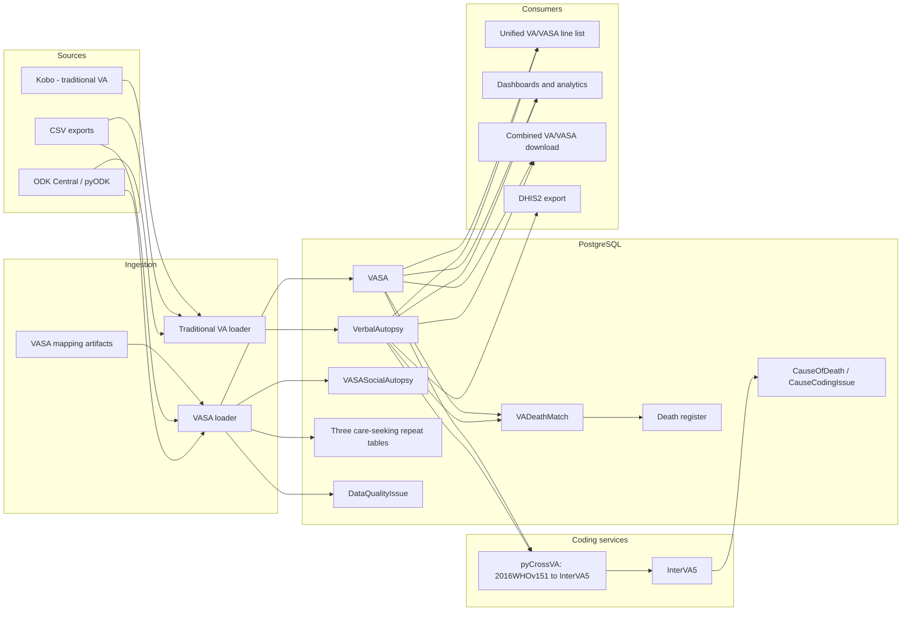

# VACMS architecture: Verbal Autopsy, VASA, WHO-variable mapping, and cause coding

## Purpose and scope

This document describes the implemented VACMS architecture, with emphasis on:

- the traditional WHO Verbal Autopsy (VA) and Verbal and Social Autopsy (VASA)
  data models;
- how VASA pseudo-variables and encoded answers are converted to the WHO 2016 VA
  identifiers and value space used by traditional VA;
- how both instruments enter the same pyCrossVA/InterVA5 cause-of-death coding
  pipeline; and
- the constraints a harmonisation workflow must preserve.

It is based on repository revision `f5d4a3fe31559bef985305336e0f500f4482472e`
on branch `dev/vasa` (14 July 2026). Counts below were re-derived from the two
XLSForms and verified with `generate_vasa_mapping --check`; they should be
regenerated whenever either form changes.

The practical conclusion is:

> The database and coding boundary already define a useful canonical format:
> one column per traditional WHO VA field (`Idxxxxx` and its helper fields),
> with select answers represented by WHO choice **names**, not VASA numeric
> choice codes. Traditional VA is already close to this format. VASA is decoded
> and renamed into it during ingestion. Social-autopsy data remains separate and
> is deliberately excluded from cause coding.

## 1. System architecture

VACMS is a Django application backed by PostgreSQL. Django serves the data
management, case management, analytics, export, administration, and user/role
interfaces. Celery uses Redis for scheduled and asynchronous ingestion, coding,
matching, and dashboard work. ODK Central is the primary collection source;
CSV and Kobo loaders also exist. Cause coding is delegated to two HTTP services:
pyCrossVA transforms WHO 2016 input into InterVA5 input, and InterVA5 assigns the
cause.



The deployment in [`docker-compose.yml`](../docker-compose.yml) defines Django,
PostgreSQL, Redis, Celery worker/beat, Flower, pyCrossVA, and InterVA5 services.
The major Django modules are:

| Module | Responsibility |
| --- | --- |
| `va_data_management` | VA/VASA and surveillance models, ingestion, validation, coding, matching, line list, and record detail views |
| `vacms` | case-management events and operational workflows |
| `home` | operational and national dashboards |
| `va_analytics` | filtered VA/VASA analysis, maps, cause and demographic summaries |
| `users` | authentication, roles, permissions, and geography-scoped querysets |
| `va_export` | combined traditional VA/VASA downloads, distinguished by the `source` output field |
| `dhis_manager` | DHIS2 integration; currently traditional VA only |
| `va_data_cleanup` / `va_admin` | data-quality review and administrative commands |

The operational domain begins with household, pregnancy, pregnancy-outcome, and
death surveillance records. `vacms.Event` schedules and tracks data collection
and VA interviews, links operational staff, and can directly FK a traditional
`VerbalAutopsy` to a `Death`. VASA does not have a direct `Event` FK; its
authoritative Death relationship is represented by `VADeathMatch`, normally
seeded from the social-autopsy `DeathID`. This distinction is why harmonisation
of questionnaire variables must not be confused with harmonisation of record
identity or case-management linkage.

Location access is hierarchical. Facility locations use the `Location`
materialised-path tree; community records can use the `SRSClusterLocation`
province/district/constituency/ward/EA hierarchy. `User.verbal_autopsies()` and
`User.vasa_records()` apply the same geographic access restrictions.

## 2. The canonical VA-shaped model

### 2.1 `BaseVerbalAutopsy`

[`models/verbal_autopsy.py`](../va_explorer/va_data_management/models/verbal_autopsy.py)
defines an abstract `BaseVerbalAutopsy`. Both concrete instruments inherit it:

```text
SoftDeletionModel
  └── BaseVerbalAutopsy (abstract)
        ├── VerbalAutopsy
        └── VASA
```

Because the base is abstract, its fields are copied into both concrete database
tables. At this revision the concrete model exposes 404 exact `Id` + digits
fields, plus WHO helper/split fields such as `Id10023_a`, `Id10148_units`, and
lower-case legacy helpers such as `id10120_unit`. The two concrete models have
the same complete WHO/helper field set even when VASA does not ask a particular
question. An unasked VASA field is stored as blank, which is the same missing
answer representation seen by coding for a blank traditional VA.

The base also contains shared collection metadata, geography, derived age and
instrument helpers, `geopoint`, timestamps, soft deletion, and these important
behaviours:

- `community_va_normalized` prefers an explicit yes/no value, otherwise infers
  community mode from district/constituency/ward/EA, or facility mode from both
  area and hospital;
- `resolve_location_context()` gives downstream code one facility/community
  geography interface;
- `linked_death` returns only an authoritative matched `VADeathMatch`; and
- normal managers hide soft-deleted rows, while `all_objects` includes them.

Questionnaire fields are text-like at this boundary, including dates and numeric
durations. This is intentional compatibility with ODK/WHO payloads. Collection
time is the exception: raw ODK `submissiondate` remains text for provenance,
while `submitted_at` is its validated, timezone-aware `DateTimeField`
representation for range queries and indexing. A shared parser normalizes aware
ISO-8601 values to UTC and interprets ISO date-only legacy values as midnight in
the configured Django timezone. Invalid nonblank values are rejected instead of
being replaced with a death date, creation time, or current time.

### 2.2 Traditional `VerbalAutopsy`

`VerbalAutopsy` adds:

- a facility `location` FK and an optional SRS `cluster` FK;
- historical auditing through `django-simple-history`;
- optional hash-based duplicate detection and a `duplicate` flag; and
- indexes for duplicate checks, date/location analytics, and soft deletion.

The traditional WHO form is
`va_explorer/static/data/znphi_va_who_v1_5_2_7.xlsx`. Its survey sheet currently
has 619 rows and 404 exact `Idxxxxx` field names. It uses the WHO identifiers as
the actual XLSForm `name` values, so no variable-name translation is required.
Its choice lists use semantic names such as `male`, `female`, `yes`, `no`, `dk`,
and `ref`; therefore traditional VA submissions normally arrive already decoded
into the value space required by pyCrossVA.

The traditional loader in
[`utils/loading.py`](../va_explorer/va_data_management/utils/loading.py):

1. composes split GPS columns;
2. strips ODK group prefixes and normalises field-name case;
3. normalises `instanceID`/Kobo UUID and constructs a missing `instanceName`;
4. coalesces `_other` fields and converts multi-select spaces to commas;
5. infers community/facility mode and assigns a facility or SRS cluster;
6. keeps only fields defined on `VerbalAutopsy`;
7. parses death and interview dates to canonical strings and normalizes the raw
   `submissiondate` into `submitted_at`;
8. bulk-creates new records with history and validates them; and
9. optionally schedules Death-register matching.

An existing `instanceid` is normally ignored rather than fully updated; the
exception is GPS enrichment. A changed Kobo UUID with the same `instanceName`
replaces the earlier record. This lifecycle differs from VASA's upsert behaviour
and matters when reconciling corrected submissions.

### 2.3 `VASA` and social-autopsy models

[`models/vasa.py`](../va_explorer/va_data_management/models/vasa.py) defines the
following:

| Model | Cardinality and purpose |
| --- | --- |
| `VASA` | One row per main VASA submission. Inherits the complete VA-shaped field set and adds ODK `key`, `instrument`, `source`, location/cluster, history, and indexes. |
| `VASASocialAutopsy` | Exactly one row per VASA (`vasa` is both the one-to-one FK and primary key). Contains 543 generated text fields for social-autopsy or unresolved inputs. |
| `VASACareSeekingNeonate` | Zero or more `br_N2213` repeat rows; 7 generated form fields plus `key`/`parent_key`. |
| `VASACareSeekingChild` | Zero or more `AD_C3253_1` repeat rows; 8 generated form fields plus keys. |
| `VASACareSeekingAdult` | Zero or more `ar_A4252` repeat rows; 7 generated form fields plus keys. |

`VASASocialAutopsy` and the repeat models are dynamically constructed from the
generated definitions in
[`vasa/model_fields.py`](../va_explorer/va_data_management/vasa/model_fields.py).
This creates real Django fields and migrations, rather than storing an opaque
JSON document. Physical separation is the main coding safety boundary: social
autopsy values are queryable and retained, but cannot enter coding merely because
their pseudo-name resembles a WHO field.

The main VASA form is
`va_explorer/static/data/znphifacilityvasa_02_final.xlsx`, form ID
`znphi_vasa_who_2016`. Its 2,257 survey rows combine common, neonate, child,
adult/maternal, social-autopsy, calculated/admin, and repeat questions. Exactly
one age instrument is expected to be populated in a submission.

### 2.4 Export and collection-date semantics

The `verbalautopsy` dataset in `/va_export/` combines active, user-visible
`VerbalAutopsy` and `VASA` records in one CSV or JSON stream. The `source`
column identifies `VA` versus `VASA`; core cause fields are outer-joined so an
uncoded record is retained with blank cause cells. Social-autopsy and repeat
tables are not flattened into this dataset. DHIS remains a separate,
traditional-VA-only integration.

For this combined dataset, `start_date` and `end_date` select the inclusive ODK
submission-date range, not the date of death. Queries use the canonical indexed
`submitted_at` field with a lower-inclusive bound at local midnight and an
upper-exclusive bound at midnight after the selected end date. `Id10023` and
the existing `date` export column continue to represent date of death. Abridged
output includes canonical `submitted_at`; full output includes both
`submitted_at` and the unchanged raw `submissiondate`.

## 3. How VASA variables map to WHO VA identifiers

### 3.1 Why two mappings are required

VASA differs from traditional VA along two independent dimensions:

1. **Column encoding:** its `name` values are VASA pseudo-names such as `Q1601`,
   `N2001`, `C3001`, or `A4006`. The corresponding WHO field has been placed in
   the XLSForm's `WHO_name` column.
2. **Answer encoding:** many VASA choice `name` values are numeric codes, such as
   `1` and `2`, whereas the WHO form uses semantic values such as `male`,
   `female`, `yes`, and `no`.

A correct harmonisation must therefore do both:

```text
(VASA pseudo-field, VASA code)
             │
             ├── field map ───────► WHO field identifier
             └── value crosswalk ─► WHO choice name

Example: (Q1601, "2") ────────────► (Id10019, "female")
```

Renaming fields without decoding values is insufficient. Decoding values while
retaining pseudo-field names is also insufficient.

### 3.2 Generated mapping artifacts

The source of truth and generated outputs are:

| Component | Role |
| --- | --- |
| VASA XLSForm `survey.name` + `survey.WHO_name` | Authoritative pseudo-name-to-WHO declaration |
| WHO XLSForm `survey` and `choices` | Valid target coverage and WHO choice names |
| [`vasa/variant_rules.py`](../va_explorer/va_data_management/vasa/variant_rules.py) | Hand-authored resolution rules for non-standard `WHO_name` values |
| [`generate_vasa_mapping.py`](../va_explorer/va_data_management/management/commands/generate_vasa_mapping.py) | Deterministic generator and validation report |
| [`vasa/field_map.py`](../va_explorer/va_data_management/vasa/field_map.py) | Generated `PSEUDO_TO_WHO`, combined fields, sections, repeat groups, and answer crosswalks |
| [`vasa/model_fields.py`](../va_explorer/va_data_management/vasa/model_fields.py) | Generated social-autopsy and repeat field definitions |

The current generated inventory is:

| Metric | Count |
| --- | ---: |
| VASA rows with non-empty `WHO_name` | 705 |
| Exact `Idxxxxx` declarations | 575 rows / 318 distinct IDs |
| Exact IDs repeated on more than one survey row | 185 |
| Exact IDs occurring in more than one instrument section | 180 |
| Pseudo-fields mapped to a VA/model target, including helpers | 661 |
| Distinct VA/model targets, including helpers | 380 |
| Exact WHO IDs covered by both forms | 320 of 404 |
| Generated select-field crosswalks | 541 fields / 2,275 code-value pairs |
| Social/unresolved main-form fields | 543 |
| Non-empty but unresolved `WHO_name` values routed to social storage | 64 |
| Admin/calculated/machinery fields not stored as questionnaire answers | 524 |

Regenerate and validate with:

```shell
python manage.py generate_vasa_mapping
python manage.py generate_vasa_mapping --check
```

The first command rewrites the two generated Python modules; it should be
followed by `makemigrations va_data_management` if generated model fields change.
The second command is the non-mutating CI/drift check.

### 3.3 Field-name resolution rules

The generator resolves against the actual `VerbalAutopsy` model field set. The
WHO XLSForm is then used for coverage reporting and answer choice matching.

| VASA `WHO_name` class | Implemented result | Example |
| --- | --- | --- |
| Exact `Id` + digits | Same model field | `Q1601: Id10019` |
| Combined abbreviated ID | Record in `COMBINED_WHO`; loader performs explicit split | `Q1202: Id10017/18`; `N2005: Id10358/9` |
| `_unit`, `_units`, or typo `_uints` | Existing singular/plural helper, case-insensitive | `A4013units -> id10120_unit` |
| `_check` | Existing check helper | `Id10071_check -> Id10071_check` |
| `z` sentinel | Social-autopsy storage, never coding | `Id10148z` |
| Suffixed split | Existing exact or underscore-normalised helper if present | `Id10023a -> Id10023_a` |
| Valid-looking ID absent from the model | Social-autopsy storage and report | `Id10078` |
| `audit`, `b`, `language` | Admin/meta, not clinical input | form machinery |
| Empty `WHO_name`, but `name` is a VA helper | Map by `name` | `age_group -> age_group` |
| Other empty `WHO_name` input | Generated social-autopsy field | `Q1203` |
| Empty calculated/admin type or known admin name | Admin/meta | `calculate`, `deviceid`, `province`, etc. |

The map stores the first target for an ordinary field. The two combined fields
are handled specially:

- **`Q1202 -> Id10017 + Id10018`:** `Q1202` is a full name. The loader reconciles
  it with the populated instrument-specific given-name field (`N2023`, `C3012`,
  or `A4001`). If there is no section value, the last whitespace token is treated
  as surname. A consistent prefix or an order-independent component match is
  resolved. On genuine disagreement, the instrument-specific name wins for
  `Id10017`, the last `Q1202` token supplies `Id10018`, and an open validity
  `DataQualityIssue` is created.
- **`N2005 -> Id10358 or Id10359`:** the numeric duration is routed to `Id10359`
  when decoded `N2005_units` is `days`; all other units route to `Id10358`.
  `Id10358_units` retains the unit.

These are semantic transformations, not simple renames, and must be explicit in
any independent harmonisation implementation.

### 3.4 Answer-value crosswalk

For each mapped VASA select field, the generator:

1. obtains its VASA choice list;
2. obtains the target WHO field's choice list;
3. normalises English labels to lower-case alphanumeric tokens;
4. reconciles known wording/spelling variants (`doesn't`/`don't` and
   `ambigous`/`ambiguous`); and
5. uses equal labels to emit `VASA code -> WHO choice name`.

If no WHO label matches during generation, the normalised VASA label is emitted
as a fallback. At ingestion, if a submitted code is absent from a generated
crosswalk, the raw code is retained. Both fallback paths require monitoring,
because they can create a value that is present but not recognised by pyCrossVA.

Examples from the committed crosswalk:

| VASA field | WHO field | Input | Canonical stored answer |
| --- | --- | --- | --- |
| `Q1601` | `Id10019` (sex) | `1`, `2`, `9` | `male`, `female`, `undetermined` |
| `Q1605` | `Id10022` (date of death known) | `1`, `2` | `yes`, `no` |
| `A4006` | `Id10064` (literacy) | `1`, `2`, `8`, `9` | `yes`, `no`, `ref`, `dk` |
| `A4010` | `Id10414` (tobacco) | `1`...`9` | semantic WHO names such as `cigarettes`, `pipe`, `refused_to_answer`, `dont_know` |
| `N2001` and `C3001` | `Id10354` | `1`, `2`, `8`, `9` | `yes`, `no`, `ref`, `dk` |

For `select_multiple`, the loader splits the VASA space-separated codes, maps
each token, and joins canonical WHO values with commas to match VACMS's
`MultiSelectField` convention.

### 3.5 Duplicate WHO IDs across instruments

The VASA form repeats many WHO concepts in neonate, child, and adult sections.
For example, both `N2001` and `C3001` map to `Id10354`; five pseudo-fields map to
`Id10360`. Repetition in the form is expected because only one age instrument
should be completed per submission.

During ingestion, `PSEUDO_TO_WHO` is processed deterministically. The first
non-blank pseudo-field sets a WHO target. An identical later value is silently
coalesced. A different later value is not allowed to overwrite the first: the
loader logs both pseudo-fields, sections, and values, keeps the first, and creates
a validity `DataQualityIssue`. The current generated dictionary is alphabetically
ordered, so “first” is deterministic but should not be treated as clinical
precedence. A harmonisation workflow should quarantine such records or apply an
explicit, reviewed precedence table rather than relying on ordering.

Instrument classification is separate from field mapping:

- populated `N2001` -> `neonate`;
- otherwise populated `C3001` -> `child`;
- otherwise populated `A4001` -> `adult`; and
- adult + female + any populated `Id10294` through `Id10310` -> `maternal`.

The trigger order is neonate, child, adult. Multiple populated instrument
triggers are therefore a data-quality condition even if no individual WHO value
conflicts.

### 3.6 Data intentionally not mapped into coding

The 64 unresolved non-empty declarations comprise:

- 41 `z` sentinel variants;
- 21 suffix variants for which no traditional VA model field exists;
- one unresolved unit field (`C3090_units / Id10285_units`); and
- one exact missing field (`N2288 / Id10078`).

They are preserved on `VASASocialAutopsy`, not discarded and not passed to
coding. Representative suffixes are `Id10007a/b`, `Id10173_nc1/nc2/nc3`,
`Id10308_1/_2`, `Id10322_a`, and `Id10336_1`. The complete operational list is
derivable from `variant_rules.py` plus the XLSForm, and is guarded by mapping
tests.

VASA has no exact declaration for 84 of the traditional form's 404 exact WHO
IDs. Those columns still exist on `VASA` but remain blank:

```text
Id10010, Id10051, Id10052, Id10053, Id10054, Id10055, Id10057, Id10060,
Id10073, Id10120, Id10121, Id10122, Id10148, Id10154, Id10162, Id10163,
Id10167, Id10169, Id10173, Id10178, Id10179, Id10182, Id10196, Id10197,
Id10198, Id10201, Id10202, Id10205, Id10206, Id10209, Id10211, Id10213,
Id10216, Id10218, Id10228, Id10232, Id10248, Id10250, Id10253, Id10262,
Id10266, Id10290, Id10307, Id10313, Id10315, Id10316, Id10322, Id10329,
Id10338, Id10347, Id10352, Id10368, Id10379, Id10391, Id10392, Id10393,
Id10412, Id10427, Id10428, Id10429, Id10430, Id10431, Id10432, Id10433,
Id10434, Id10443, Id10450, Id10451, Id10455, Id10456, Id10457, Id10459,
Id10470, Id10471, Id10472, Id10473, Id10478, Id10482, Id10483, Id10484,
Id10485, Id10486, Id10487, Id10488
```

Some are calculated finals whose raw components or sentinel variants exist in
VASA. They must not be invented from a superficially similar field unless a
clinically reviewed derivation rule is added and regression-tested.

## 4. VASA ingestion implementation

The shared implementation is
[`utils/vasa_loading.py`](../va_explorer/va_data_management/utils/vasa_loading.py).
Both CSV and ODK paths call it.

### 4.1 Main-record transformation

For each source row the loader:

1. composes `GPS-*` into `geopoint`;
2. looks up each pseudo-name in `PSEUDO_TO_WHO`;
3. decodes select values with `VALUE_CROSSWALK`;
4. coalesces duplicate targets and records conflicts;
5. applies the `Q1202` and `N2005` semantic split rules;
6. copies supported admin/location columns;
7. normalises `instanceID` and ODK `KEY`;
8. detects the instrument;
9. parses `Id10023` and `Id10012` dates and normalizes raw `submissiondate` into
   canonical `submitted_at`;
10. routes generated social fields to `VASASocialAutopsy`;
11. upserts the main record by `instanceid` inside a per-row transaction; and
12. validates `DeathID`, resolves stale conflict issues, and optionally schedules
    Death-register matching.

One malformed record is logged and skipped without rolling back the rest of the
batch. The main VASA upsert updates an existing record, unlike traditional VA.
Only meaningful incoming values are put into the update dictionaries, so an
empty correction does **not** clear a previously stored main, social, or repeat
answer. A harmonisation workflow needs an explicit null/blank policy rather than
assuming a blank re-import retracts earlier data.

`VASASocialAutopsy` is always created, even if all its answers are blank. VASA
uses `all_objects` to locate an existing row, so updating a soft-deleted row does
not automatically restore it.

### 4.2 Repeat groups

Repeat exports join as `child.PARENT_KEY -> VASA.key`. Within a parent, the
loader performs `update_or_create(vasa, key)`. A blank parent key, unknown parent,
or unknown repeat group is skipped and counted. Child keys are not declared as
database-unique, so the application-level `(vasa, key)` upsert convention must
be preserved.

### 4.3 ODK Central path

[`odk/service.py`](../va_explorer/va_data_management/odk/service.py) provides
per-form locking, incremental watermarks, and pyODK access. `ODK_PULL_FORMS` in
[`config/settings/base.py`](../config/settings/base.py) registers the VASA main
table and three repeat tables against the same `ODK_VASA_FORM_ID`. ODK exposes
repeats through these OData tables:

| Configured form name | OData table / mapping group |
| --- | --- |
| `vasa` | main `Submissions` table |
| `vasa_care_seeking_neonate` | `Submissions.br_N2213` |
| `vasa_care_seeking_child` | `Submissions.AD_C3253_1` |
| `vasa_care_seeking_adult` | `Submissions.ar_A4252` |

The main table must be available before independently pulled repeats can resolve
their parent. Scheduled VASA pulls use the `va_hourly` schedule. The service
tracks pull state and server/submission watermarks, uses an overlap window, and
locks by form/project; a full refresh also takes a project-wide lock.

### 4.4 `DeathID` and Death-register linkage

VASA carries a field-entered `DeathID` on `VASASocialAutopsy`, not on the
VA-shaped `VASA` table. After each non-dry-run load, all non-blank VASA Death IDs
are checked for format/checksum and existence in `Death.death_id`. Problems are
non-blocking validity issues and self-resolve after correction or after the Death
appears.

If `VA_DEATH_MATCH_ENABLED` is enabled, VASA first tries the exact social-autopsy
Death ID. Traditional VA first tries its case-management `Event -> Death` bridge.
Both can fall back to explainable fuzzy demographic/geographic matching and
write one audited `VADeathMatch` row. This linkage is separate from cause coding.

## 5. Shared VA coding implementation

### 5.1 Eligibility and input

[`utils/coding.py`](../va_explorer/va_data_management/utils/coding.py) loops over
`VerbalAutopsy` and `VASA` separately and selects records with no related
`CauseOfDeath`. It currently supports only InterVA5, with environment-controlled
HIV prevalence, malaria prevalence, and group-code settings.

`build_pycrossva_records()` uses Django `model_to_dict()` and prefixes every key
with `-`, as expected by pyCrossVA. The essential parity is that both concrete
models expose the same WHO/helper keys and canonical values. A nuance worth
preserving in tests is that the function does **not** filter strictly to
`Idxxxxx`: it also emits shared metadata and model-specific fields (`instrument`,
`key`, `source` for VASA; duplicate fields for VA). VACMS relies on the configured
pyCrossVA input mapping to select or ignore those extra columns; it does not
filter them itself. Social-autopsy and repeat fields are absent because they live
on other model instances.

### 5.2 Transformation and algorithm call

The implemented sequence is:

```text
VA or canonicalised VASA model rows
  -> model_to_dict
  -> prefix columns with "-"
  -> CSV
  -> POST /transform?input=2016WHOv151&output=InterVA5
  -> parse transformed CSV and rename blank index header to ID
  -> JSON {Input: rows, HIV, Malaria, groupcode, api}
  -> replace string "0.0" with "." and "1.0" with "y"
  -> POST /interva5
  -> causes + warnings/errors
```

The returned `ID` is treated as a one-based row offset into the submitted batch.
Ordering must therefore remain stable from request construction to response
handling.

### 5.3 Stored coding result

Only `CAUSE1` is persisted. Empty `CAUSE1` with `INDET == 100` and blank `LIK1`
is stored as `Indeterminate`. The current `CauseOfDeath` model stores:

- the cause text;
- algorithm (`InterVA5`);
- the algorithm settings JSON;
- timestamps/history; and
- exactly one nullable parent FK: `verbalautopsy` or `vasa`.

A database check constraint rejects both-parent and no-parent rows. The same
exactly-one-parent design is used by `CauseCodingIssue` and `DhisStatus`.
Soft-delete-aware managers hide a coding row when its parent is soft-deleted.
Warnings and errors returned by InterVA5 are stored in `CauseCodingIssue` with
their severity and settings.

Likelihood, secondary/tertiary causes, and the complete InterVA response are not
stored. Although the schema permits several causes per record, eligibility is
currently “has no cause from any algorithm,” not “has no cause for this algorithm.”
Analytics choose the newest cause by `created` time as the final cause.

### 5.4 Synchronous and Celery execution

`python manage.py run_coding_algorithms` runs the synchronous utility. Celery's
daily orchestrator snapshots uncoded IDs for each model and dispatches stable
500-ID batches, tagging each batch with `verbalautopsy` or `vasa` so results use
the correct FK.

For a production harmonisation/backfill, prefer the snapshot-ID batching pattern.
The synchronous utility calculates offsets over a queryset that shrinks as
causes are inserted; with more than one batch this can skip records. The Celery
orchestrator avoids that problem by snapshotting IDs before any coding occurs.

## 6. Recommended harmonisation workflow

The workflow should make canonicalisation an explicit, testable stage before
coding. It should not infer canonical state merely from the source model name.

### 6.1 Canonical contract

Define a versioned canonical record with:

```text
record_identity
  source_type: traditional_va | vasa
  source_form_id and source_form_version
  source_instance_id / ODK key
  mapping_version (XLSForm hashes + code revision)

canonical_answers
  WHO/model field -> canonical value

provenance per answer
  source_column
  raw_value
  canonical_field
  canonical_value
  field_rule: exact | unit | check | suffix | combined | helper-by-name
  value_rule: already_canonical | crosswalk | fallback | unknown
  instrument_section

non_coding_answers
  social-autopsy values and repeats

quality
  unknown fields/codes
  collisions and their resolution
  invalid/missing identifiers and dates
  coding eligibility
```

The existing database is the operational canonical store, but it does not retain
the raw encoded VASA answer beside every decoded answer. A harmonisation process
should keep an immutable raw/staging representation or provenance table so a new
mapping version can be replayed and audited.

### 6.2 Source adapters

Use two source-specific adapters feeding one validator:

- **Traditional VA adapter:** case-normalise WHO column names, retain already
  semantic WHO values, normalise known synonyms only through an explicit WHO
  value dictionary, and flag numeric codes rather than assuming VASA semantics.
- **VASA adapter:** use the generated `PSEUDO_TO_WHO`, `COMBINED_WHO`, and
  `VALUE_CROSSWALK`; never apply the same numeric mapping merely because two
  unrelated VASA fields both contain `1`.

The crosswalk is field-specific. A global `1=yes`, `2=no` decoder would corrupt
sex, marital status, units, tobacco, and many other fields.

### 6.3 Mapping and collision rules

Process one submission at a time:

1. identify its source form and version;
2. normalise blank representations without confusing a genuine zero with blank;
3. map each source field to zero, one, or several canonical targets;
4. decode each select answer using the source-field-specific crosswalk;
5. normalise multi-select ordering/delimiters if order is not meaningful;
6. apply only the reviewed `Q1202` and `N2005` semantic transforms;
7. group candidate answers by canonical WHO field;
8. accept one non-blank value or identical values;
9. apply an explicit, clinically reviewed precedence rule where available;
10. otherwise retain all candidates in provenance, mark a collision, and block
    automatic coding for that record; and
11. route SA/unresolved/admin data to its declared non-coding destination.

Do not fill the 84 VASA-absent WHO IDs from similarly named variants without an
approved rule. Blank is safer and matches current coding behaviour.

### 6.4 Validation gates before coding

At minimum, reject or quarantine a canonical row from automatic coding when:

- its source form/version has no approved mapping version;
- an encoded select code is missing from the field crosswalk;
- a mapped value is outside the target WHO choice list;
- two populated sections disagree for the same WHO field;
- more than one neonate/child/adult trigger is populated;
- the record lacks a stable source identity; or
- a combined-field transformation cannot be explained in provenance.

Also report, without necessarily blocking, missing VASA-only coverage, unknown
admin columns, date parsing failures, social-autopsy Death ID issues, and missing
location linkage.

Recommended batch invariants are:

```text
input rows = canonical rows + quarantined rows + fatal rows
no source column is silently dropped
no source answer is silently overwritten
every decoded select value names the crosswalk entry used
every coded row has zero unresolved WHO-field conflicts
re-running the same mapping version is idempotent
```

### 6.5 Versioning and regression fixtures

Version the mapping by hashes of both XLSForms plus the mapping code revision.
Regeneration should produce:

- the field map and value crosswalk;
- coverage and unresolved-field reports;
- a diff against the prior mapping version;
- database migration requirements for SA/repeat changes; and
- a release decision for any newly mapped, unmapped, or redefined variable.

Keep golden cases for:

- direct mapping (`Q1601/2 -> Id10019/female`);
- every variant-rule class;
- all select lists and unknown-code handling;
- single and multiple selection;
- duplicated IDs with identical and conflicting values;
- each name reconciliation outcome;
- `N2005` day/non-day routing;
- neonate, child, adult, and maternal detection;
- all three repeat joins;
- blank retractions versus absent fields;
- parity of canonical VA and VASA pyCrossVA `-Id...` inputs; and
- stable response-to-record association across coding batches.

Existing tests in `va_data_management/tests/test_vasa_*.py` provide a strong
starting point, but the workflow should add a full crosswalk-domain test: every
accepted source code must produce a value allowed by the target WHO choice list.

## 7. Important implementation constraints and gaps

These are relevant when deciding whether to reuse current code directly or
extract a standalone harmonisation service:

1. **No raw-answer ledger.** Canonical VASA values replace numeric codes on the
   main model. Reprocessing after a mapping change requires the source export or
   ODK data unless raw provenance is added.
2. **Blank updates do not clear old VASA values.** Absence and retraction are not
   distinguished by the current upsert dictionaries.
3. **Crosswalk fallbacks are permissive.** An unmatched generated label becomes a
   normalised label; an unknown submitted code remains raw. Both should be made
   observable and optionally coding-blocking.
4. **Collision precedence is ordering-based.** Ordinary conflicting duplicate
   WHO IDs keep the first generated-map entry. This is deterministic, not a
   clinical precedence rule.
5. **Name splitting is culturally simplistic.** Treating the final whitespace
   token as surname is an explicit current heuristic and should remain auditable.
6. **Coding transport is not hardened.** The current HTTP calls have no explicit
   timeout, retry, `raise_for_status`, or persisted raw request/response. A
   service failure can abort a batch after partial work.
7. **Coding stores a reduced result.** Only top cause and settings are retained;
   probabilities, other candidate causes, and the full response are lost.
8. **The synchronous coder can skip large-batch records.** Use snapshot-ID Celery
   batches or fix the iterator before a bulk backfill.
9. **Overwrite CLI parsing is unsafe for automation.** `--overwrite` uses Python
   `bool` argument parsing, for which a non-empty string such as `False` is true.
   Avoid it in an automated harmonisation workflow until corrected.
10. **Combined export deliberately covers core records only.** `va_export`
    streams traditional VA and VASA records together, but does not flatten VASA
    social-autopsy or care-seeking repeat tables into the same schema.
11. **DHIS export is traditional-VA-only.** `run_dhis` queries
    `VerbalAutopsy` and `verbalautopsy_id`, despite shared `DhisStatus` support.
12. **Multiple-algorithm semantics are incomplete.** Any existing cause makes a
    record ineligible, and analytics select the latest cause rather than an
    explicitly adjudicated result.
13. **Attachments are not ingested.** ODK attachment download is currently a
    placeholder; harmonisation covers tabular answers only.
14. **VASA ODK pull state is shared across four table configurations.** The main
    form and three repeats use the same `(form_id, project_id)` state/lock key,
    and `pull_forms()` also keys its returned summary only by `form_id`. The
    overlap window reduces missed-row risk, but independent table watermarks and
    distinct summary keys would be safer and more observable.

## 8. Verification and code-reading index

The following checks passed while preparing this document:

```shell
python manage.py generate_vasa_mapping --check
# VASA mapping artifacts are up to date.

pytest -q \
  va_explorer/va_data_management/tests/test_vasa_mapping.py \
  va_explorer/va_data_management/tests/test_vasa_models.py \
  va_explorer/va_data_management/tests/test_vasa_coding.py \
  va_explorer/va_data_management/tests/test_vasa_cod.py
# 49 passed

pytest -q \
  va_explorer/va_data_management/tests/test_vasa_loading.py \
  va_explorer/va_data_management/tests/test_odk_normalization.py \
  va_explorer/va_data_management/tests/test_vasa_line_list_and_detail.py
# 30 passed
```

Primary implementation references:

- [`models/verbal_autopsy.py`](../va_explorer/va_data_management/models/verbal_autopsy.py)
  — shared model, traditional model, cause/coding models.
- [`models/vasa.py`](../va_explorer/va_data_management/models/vasa.py) — VASA,
  social-autopsy, and repeat models.
- [`vasa/variant_rules.py`](../va_explorer/va_data_management/vasa/variant_rules.py)
  — non-standard WHO-name classifications.
- [`vasa/field_map.py`](../va_explorer/va_data_management/vasa/field_map.py) —
  complete generated variable and value mapping.
- [`utils/vasa_loading.py`](../va_explorer/va_data_management/utils/vasa_loading.py)
  — runtime mapping, collision handling, social split, and upserts.
- [`utils/loading.py`](../va_explorer/va_data_management/utils/loading.py) —
  traditional VA ingestion.
- [`utils/coding.py`](../va_explorer/va_data_management/utils/coding.py) — shared
  pyCrossVA/InterVA5 coding implementation.
- [`tasks.py`](../va_explorer/va_data_management/tasks.py) — scheduled ingestion,
  stable coding batches, and Death matching.
- [`odk/service.py`](../va_explorer/va_data_management/odk/service.py) — ODK
  pulling, locks, watermarks, and loader routing.
- [`test_vasa_mapping.py`](../va_explorer/va_data_management/tests/test_vasa_mapping.py),
  [`test_vasa_loading.py`](../va_explorer/va_data_management/tests/test_vasa_loading.py),
  and [`test_vasa_coding.py`](../va_explorer/va_data_management/tests/test_vasa_coding.py)
  — executable mapping, ingestion, and coding contracts.
