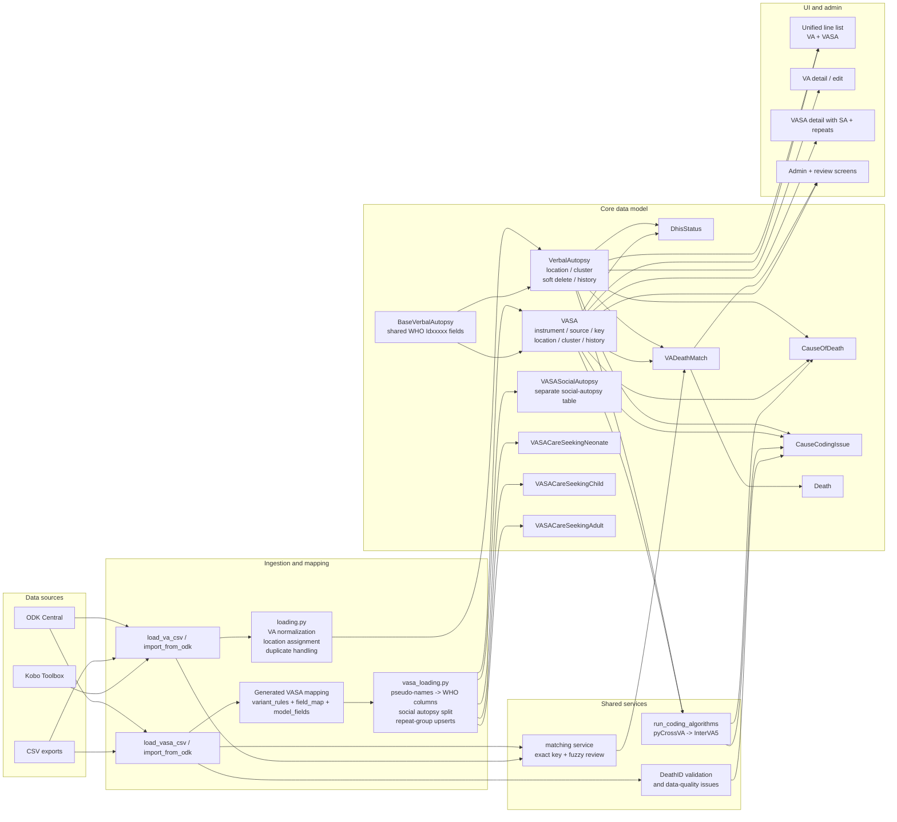

# VASA (Verbal + Social Autopsy)

VACMS ingests and codes the **VASA** ODK form (`znphi_vasa_who_2016`, XLSForm
`znphifacilityvasa_02_final.xlsx`) alongside the existing WHO Verbal Autopsy (VA)
form. VASA bundles four WHO instruments — **Neonate**, **Child**, **Adult**
(with **Maternal** nested under Adult) — plus **social-autopsy** questions and
three care-seeking **repeat groups**. Exactly one instrument section is completed
per submission.

VASA reuses the VA cause-of-death pipeline unchanged wherever possible: VASA
records carry the same WHO `Idxxxxx` columns as VA, and their coding results are
stored in the same `CauseOfDeath` / `CauseCodingIssue` / `DhisStatus` tables.

## Architecture diagram



## Data model

| Model | Purpose |
| --- | --- |
| `BaseVerbalAutopsy` (abstract) | All shared WHO `Idxxxxx` columns + metadata/geo helpers. `VerbalAutopsy` and `VASA` both inherit it, so the two cannot drift apart. |
| `VASA` | A VASA record. Inherits every WHO column (Ids absent from the VASA form are simply blank), and adds `instrument` (neonate/child/adult/maternal), `source`, `key`, its own `location`/`cluster` FKs, and history. Soft-deletable like VA. |
| `VASASocialAutopsy` | One-to-one with `VASA`; ~550 generated typed columns for the empty-`WHO_name` social-autopsy questions. **Physically separate from `VASA`, so SA data can never enter coding input.** |
| `VASACareSeekingNeonate` / `Child` / `Adult` | One model per repeat group (`br_N2213` / `AD_C3253_1` / `ar_A4252`), FK'd to `VASA`, keyed by `key`/`parent_key`. |
| `CauseOfDeath` / `CauseCodingIssue` / `DhisStatus` | Shared. Each now has a nullable `vasa` FK alongside `verbalautopsy`; a DB check enforces exactly one parent, and the soft-delete managers hide a row when *its* parent is soft-deleted. |

## Mapping pipeline

The VASA survey uses pseudo-names (`Q1xxx`/`N2xxx`/`C3xxx`/`A4xxx`/helper calcs)
in its `name` column and moves the original WHO name to a `WHO_name` column. The
mapping from pseudo-names to WHO columns is **generated**, not hand-maintained.

- `va_data_management/vasa/variant_rules.py` — hand-authored, dependency-free
  rule table. Resolves every non-standard `WHO_name` class against the
  `VerbalAutopsy` field set and classifies each field `va` / `sa` / `admin_meta`:
  exact `Id\d+`, combined `IdX/Y` (split into both components), `_unit`/`_units`/
  `_uints` (typo), `_check`, `z`-sentinel (→ SA), suffixed splits, and junk
  (`audit`/`b`/`language`). An empty-`WHO_name` field whose *name* is itself a VA
  column (e.g. `age_group`) maps to that column.
- `va_data_management/vasa/field_map.py` — **generated**: `PSEUDO_TO_WHO`,
  `COMBINED_WHO`, `INSTRUMENT_SECTION`, `REPEAT_GROUPS`, and `VALUE_CROSSWALK`
  (VASA select code → WHO value, e.g. `1` → `yes`, obtained by matching the VASA
  choice label to the WHO form's choice label). Companion decode metadata:
  `SELECT_TYPES` (`select_one`/`select_multiple` per crosswalked field),
  `FALLBACK_CODES` (codes whose value is a normalised-label fallback because no
  WHO label matched at generation time), `XLSFORM_HASHES` (sha256 of both source
  workbooks) and `CROSSWALK_VERSION` (short hash pair versioning every decode).
- `va_data_management/vasa/model_fields.py` — **generated**: typed field
  definitions for `VASASocialAutopsy` and the three repeat models, plus
  `SA_VALUE_LABELS` (display-only choice labels for SA/repeat select columns).
- `va_data_management/vasa/value_decode.py` — hand-written, pure decoder over
  the generated crosswalk: `decode_value()` / `decode_row()` return a
  `DecodeResult` classifying every answer (`crosswalk` / `fallback` /
  `unknown_code` / `blank` / `already_canonical` / `passthrough`). Decoding is
  strictly field-specific — there is no global `1=yes` rule — and idempotent
  (already-canonical values pass through). `select_multiple` raw values are
  whitespace-split, decoded per token and comma-joined (the `MultiSelectField`
  convention). Blank stays blank; `"0"` is a code, never a blank.

  A note on casing: the WHO form itself uses both `Ref`/`ref` and `DK`/`dk` as
  choice names on different lists, so matched WHO values keep the WHO form's
  exact casing (coding expects it). Fallback values derive from `_norm_label`
  and are lowercase by construction; `test_vasa_mapping.py` enforces both.

### Regenerating after a form revision

The two generated modules are produced (and verified) by a management command:

```shell
# Regenerate field_map.py + model_fields.py and print the validation report
python manage.py generate_vasa_mapping

# CI / test guard: fail if the committed artifacts drift from the XLSForm
python manage.py generate_vasa_mapping --check
```

Inputs default to `va_explorer/static/data/znphifacilityvasa_02_final.xlsx` (VASA)
and `znphi_va_who_v1_5_2_7.xlsx` (WHO, for the coverage report); override with
`--xlsform` / `--who-xlsform`. After regenerating, run
`makemigrations va_data_management` — a changed SA/repeat field set produces a new
migration. The generator is deterministic; `test_vasa_mapping.py` asserts
`--check` passes.

The validation report summarises: VA fields mapped, distinct WHO Ids covered,
combined splits, SA questions, admin/meta fields, repeat groups, WHO_names
missing from the VA model (`Id10078`), WHO Ids in the WHO form not covered by
VASA, and unresolved `WHO_name`s routed to SA (nothing is silently dropped).

## Ingestion

### From CSV

```shell
python manage.py load_vasa_csv path/to/main.csv \
    --repeat br_N2213=path/to/neonate_repeat.csv \
    --repeat AD_C3253_1=path/to/child_repeat.csv \
    --repeat ar_A4252=path/to/adult_repeat.csv
```

The loader (`utils/vasa_loading.py`):
1. composes the GPS geopoint from the `GPS-*` columns;
2. maps pseudo-names → WHO columns, coalescing WHO Ids that repeat across the
   mutually exclusive instrument sections (collisions are logged);
3. decodes select codes to the WHO value-space via `vasa/value_decode.py` and
   adopts them **in place** on the canonical `Idxxxxx` fields — the same values
   `build_pycrossva_records()` sends to coding, so decoded value == stored
   value == coding input;
4. parses date-of-death / interview dates;
5. detects the instrument (neonate/child/adult, refined to maternal for a
   female-adult pregnancy death);
6. routes empty-`WHO_name` answers to `VASASocialAutopsy`;
7. upserts idempotently by `instanceID` with per-record error isolation;
8. links repeat rows to their parent `VASA` by `KEY`.

Legacy facility-era exports (`province`/`area`/`hospital`, no `constituency`/
`ward`/`ea`) are tolerated.

### Decode provenance, data quality and replay

Every crosswalked select answer's **raw code** is preserved on
`VASA.raw_answers` (`{"values": {pseudo: raw}, "meta": {crosswalk_version,
form_id}}`, merged per import — a blank re-import never clears raws, matching
the canonical-field blank policy). The field is `editable=False`, so it never
enters coding input (`model_to_dict`) or the detail form.

Decode problems surface as non-blocking `DataQualityIssue`s (VALIDITY), keyed
`{"check": "unknown_code"|"fallback_value", "who": <Id>}` so a corrected
re-import updates — and auto-resolves — the same issue. An unknown code is
retained in place verbatim (never fabricated). Each batch logs a decode summary
(fields decoded, unknown/fallback counts) and reports it under
`summary["decode"]`.

After a crosswalk change, replay the decode from provenance:

```shell
python manage.py redecode_vasa --dry-run   # report what would change
python manage.py redecode_vasa             # adopt new decoded values in place
```

Replay covers plain crosswalked fields only; combined-field routing
(`Q1202`/`N2005`) and admin/location columns are loader concerns — a re-import
repairs those.

### UI display

Because the stored canonical value *is* the WHO-canonical name, the line list
and the VASA detail page read the fields directly — no display-time decode for
WHO answers. SA/care-seeking values stay stored as raw codes but are decoded to
their choice labels at render time only (`sa_display_value` +
`SA_VALUE_LABELS`); coding input is unaffected.

### From ODK Central

The VASA form and its three repeat tables are registered in `ODK_PULL_FORMS`
(`config/settings/base.py`) under form names `vasa`, `vasa_care_seeking_neonate`,
`vasa_care_seeking_child`, `vasa_care_seeking_adult`. Set `ODK_VASA_FORM_ID` and
pull with `python manage.py import_from_odk` (or the scheduled Celery task).
`ODKPullService.upsert_into_models` routes those form names to the VASA loader;
`FORM_REPEAT_TABLE_MAP` maps the repeat forms to their OData tables.

## Coding

`run_coding_algorithms()` (and the Celery orchestrator) code both `VerbalAutopsy`
and `VASA` records that lack a cause. `build_pycrossva_records()` builds the
pyCrossVA input from `model_to_dict`, which yields only the WHO columns — social
autopsy, living on a separate model, is structurally excluded. `run_interva5(...,
fk_field="vasa")` stores the results against the `vasa` FK. WHO Ids absent from
the VASA form arrive as blank answers, exactly as a blank VA answer would.

```shell
python manage.py run_coding_algorithms      # codes uncoded VA and VASA records
```

## Tests

- `test_vasa_mapping.py` — every variant-rule class + generated-artifact shape + generator idempotency.
- `test_vasa_models.py` — VASA/VA share the WHO columns; SA is off the VASA record; soft delete.
- `test_vasa_cod.py` — shared COD tables, the exactly-one-parent constraint, and manager soft-delete filtering.
- `test_vasa_loading.py` — the four sample fixtures: 6 records (2/1/3), repeats 3/0/4, idempotency, legacy tolerance, geopoint, value decoding, decode DQ issues, raw-answer provenance, batch decode summary.
- `test_vasa_coding.py` — VASA vs VA input parity (including loader-decoded parity), SA + `raw_answers` exclusion, absent-Id blanks, and FK routing.
- `test_vasa_value_decode.py` — the pure decoder: every `value_rule`, multi-select join, blank-vs-zero, idempotency, SA display labels.
- `test_vasa_redecode.py` — provenance replay: repairs stale decodes, dry-run safety, combined-target exclusion, decode-issue lifecycle.
- `test_vasa_line_list_and_detail.py` — VASA rows/routing in the line list; detail tabs; decoded WHO values (no raw codes) and SA choice labels.
